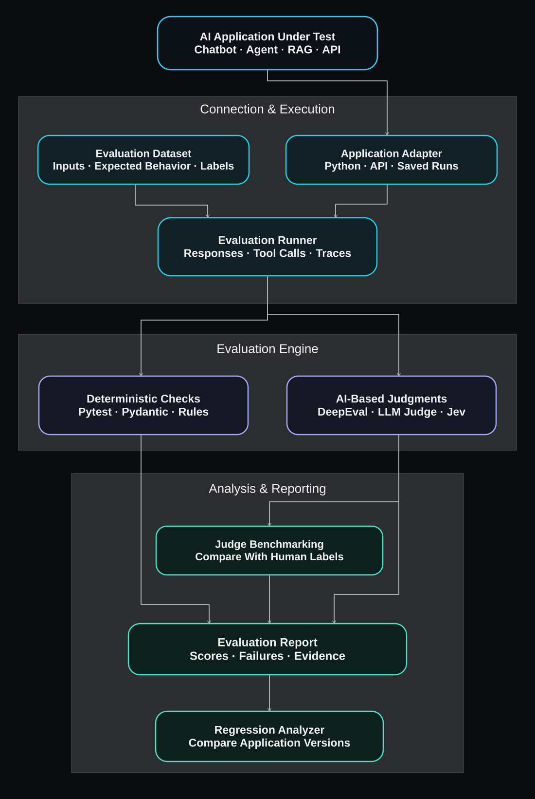
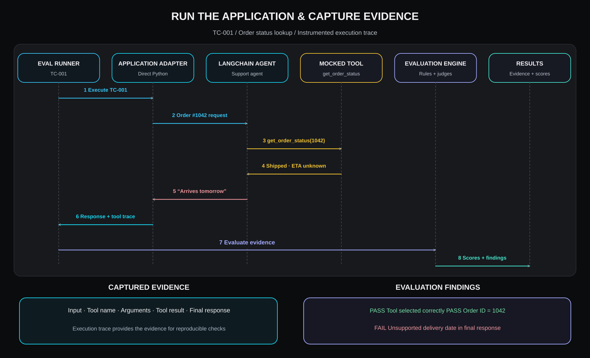

# AI Eval

### An AI application testing and reliability framework

**AI Eval** is a reusable evaluation harness designed to test AI applications, measure their reliability, validate agent behavior, and detect regressions between versions.

Traditional tests can check exact outputs. AI applications also need tests for behaviors that are harder to define precisely: whether an answer is supported by evidence, whether an agent selected the right tool, and whether its response followed instructions. AI Eval combines **deterministic checks** with **AI-based judgments** and makes the results comparable and explainable.

> **Project status:** Architecture and design specification. The diagrams and reports below describe the intended system; sample scores are illustrative, not measured results.

## At a glance

| | |
| --- | --- |
| **Goal** | Evaluate AI applications systematically, rather than manually reviewing individual outputs. |
| **Applications** | AI agents, chatbots, RAG applications, and other AI-powered APIs. |
| **Core stack** | Python, LangChain, Pytest, Pydantic, DeepEval, and Jev (TypeSafe AI). |
| **Output** | Per-test results, failure explanations, judge comparisons, and regression reports. |
| **Design principle** | Test the **behavior** of an application, not only the wording of its final answer. |

## System Architecture

The diagram below illustrates how AI Eval connects to AI applications,
runs evaluations, and generates reliability reports.

### Component responsibilities

| Component | Responsibility |
| --- | --- |
| **Application Adapter** | Connects to the application under test or imports previously captured executions. |
| **Dataset Manager** | Maintains test inputs, expected behaviors, reference facts, and human labels. |
| **Evaluation Runner** | Executes scenarios and captures responses, tool calls, and available traces. |
| **Evaluation Engine** | Runs deterministic assertions and AI-based evaluation metrics. |
| **Judge Benchmarking** | Compares AI judges against human-labeled cases and analyzes disagreements. |
| **Regression Analyzer** | Identifies quality changes between prompt, model, or application versions. |
| **Report Generator** | Presents scores, failures, evidence, latency, and cost measurements. |

**Important distinction:** LangChain is used to build the initial *application under test*. DeepEval is the evaluation framework; Jev is a judging approach within the evaluation design. AI Eval itself is the surrounding harness that connects applications, runs cases, aggregates outcomes, and produces reports. The exact Jev integration and supported judging modes will be validated during implementation.

## How AI Eval tests an application

The first application under test will be a **fictional customer support agent** built with LangChain. It has three tools backed by simulated data to make tests reproducible:

| Tool | Purpose |
| --- | --- |
| `get_order_status` | Looks up an order's shipping status. |
| `search_policy` | Retrieves the company's support policies. |
| `create_support_ticket` | Creates a support request. |

### 1. Connect to the application

AI Eval is designed to support multiple integration methods:

| Method | How it works | What can be evaluated |
| --- | --- | --- |
| **Direct Python** | Execute an imported AI application. | Responses and any instrumented execution traces. |
| **HTTP API** | Send test requests to an application endpoint. | Usually final responses; internal tool use only if traces are exposed. |
| **Saved executions** | Import recorded responses and tool calls. | The evidence present in the saved records. |

The initial design focuses on direct Python execution. API and saved-execution adapters are extension points—not a claim that any arbitrary application can be fully inspected.

### 2. Define evaluation scenarios

Each scenario specifies an **input**, **expected behavior**, and enough **reference information** to determine whether the application behaved acceptably.

#### Example: `TC-001` — Order status lookup

| Field | Value |
| --- | --- |
| User input | “What's the shipping status of order #1042?” |
| Expected tool | `get_order_status` |
| Expected arguments | Order ID `1042` |
| Mocked tool result | **Shipped**; estimated delivery date **unavailable**. |
| Behavioral requirement | Report the retrieved status and do not invent delivery information. |

The target dataset will contain approximately **25 scenarios** spanning normal requests, missing data, invalid tool arguments, incorrect tool selection, instruction adherence, and guardrail violations. Reference outcomes act as *ground truth* or *golden examples* for the checks they support.

### 3. Run the application and capture evidence

The agent selected the correct tool and supplied the correct order ID, but **invented a delivery date**. It should pass the tool-call checks and fail the evaluation for unsupported information.

That distinction is the heart of the project: an agent can do part of a task correctly while still giving an unreliable final answer.

## Evaluation layers

### Layer 1 — Deterministic evaluation

Deterministic checks verify facts that can be directly established from the execution evidence. They use **Python, Pytest, and Pydantic**, without requiring a second AI model to judge the result.

| Check | Example outcome for `TC-001` |
| --- | --- |
| Correct tool selected? | **Pass** — `get_order_status` was called. |
| Correct order ID supplied? | **Pass** — `1042` was used. |
| Tool argument schema valid? | **Pass** — arguments match the expected structure. |
| Required tool step performed? | **Pass** — the order lookup occurred. |

A deterministic test should only claim what its available evidence proves. For example, validating a tool trace does **not** prove that the final natural-language response is accurate.

### Layer 2 — AI-based evaluation

Some quality questions are not conveniently expressed as exact-match rules:

- Is the response supported by the tool results or retrieved evidence?
- Did the agent follow the user's intent and applicable instructions?
- Is the response relevant and appropriately complete?
- Did the agent make claims it cannot substantiate?

These judgments will be orchestrated with **DeepEval**, using suitable LLM-based metrics and exploring **Jev** and hybrid approaches where supported.

| Judging approach | Concept |
| --- | --- |
| **LLM judge** | An LLM evaluates the application's output against a rubric or expected behavior. |
| **Jev judge** | A probabilistic judge makes bounded decisions for suitable evaluation questions. |
| **Hybrid judge** | Combines LLM-based interpretation with Jev-based decisions, where compatible. |

AI-generated judgments are **not ground truth**. They can be inconsistent or incorrect, which is why AI Eval also measures the quality of the judges themselves.

### Guardrail evaluation

The harness will test whether an application respects its own constraints, including:

- Following support policies instead of making unsupported commitments.
- Avoiding fabricated facts when the required information is unavailable.
- Rejecting or safely handling invalid tool requests.
- Maintaining instruction adherence under confusing or adversarial inputs.

Where a rule is directly observable, use deterministic assertions. Where interpretation is required, use a judged metric and investigate borderline cases.

## Judge benchmarking: evaluating the evaluators

A reliable evaluation framework cannot assume its judges are always right. AI Eval will use a small **human-labeled benchmark** and compare each judge's decisions against those labels.

| Example scenario | Human label | LLM judge | Jev judge |
| --- | --- | --- | --- |
| Correct order status | Pass | Pass | Pass |
| Invented delivery date | Fail | Fail | Fail |
| Unnecessary tool call | Fail | Pass | Fail |
| Properly declines unsupported action | Pass | Pass | Fail |

*Illustrative labels only; not an experimental result.*

The report will examine **agreement with human labels**, **false passes / false failures**, **judge disagreements**, **latency**, and **evaluation cost**. Disagreements will be reviewed rather than automatically resolved by majority vote.

## Regression testing

AI Eval will compare different versions of an application using the **same evaluation cases**. This helps answer a critical question: *Did the latest prompt, model, or tool change improve the application—or make something worse?*

### Example regression report

| Metric | Version 1 | Version 2 | Interpretation |
| --- | ---: | ---: | --- |
| Tool correctness | 90% | 96% | Improved |
| Instruction adherence | 94% | 81% | **Regressed** |
| Task completion | 88% | 91% | Improved |

**Illustrative outcome:** Review required. Better tool selection does not excuse a meaningful drop in instruction adherence.

Because AI behavior is not perfectly repeatable, selected tests should be run multiple times under controlled conditions. Comparisons should use consistent datasets, evaluator configurations, and scoring thresholds.

## Expected evaluation report

A completed run should answer:

1. **Did the application satisfy each test case?** Show deterministic pass/fail results and judged scores.
2. **Why did it fail?** Include the evidence, relevant tool trace, and judge explanation when available.
3. **How trustworthy is the judge?** Summarize agreement and disagreements against labeled examples.
4. **Did a new version regress?** Surface metric changes and cases that changed from passing to failing.
5. **What did the run cost?** Report available latency and token/cost measurements, with missing measurements explicitly noted.

Reports are planned in **JSON and human-readable HTML**, rather than requiring a full web dashboard.

## Scope and constraints

**In scope**

- A reusable Python harness around an initial LangChain test agent.
- Dataset-driven execution with reproducible mocked tools.
- Deterministic and AI-based evaluation layers.
- Guardrail checks and evaluation failure analysis.
- Small-scale benchmarking against human labels.
- Baseline-versus-candidate regression comparisons.
- Exportable evaluation reports.

**Out of scope for the initial implementation**

- Building a production SaaS platform, authentication, or billing.
- A custom database or frontend dashboard.
- Reimplementing DeepEval's underlying metrics.
- Claiming visibility into third-party agents' internal tool calls when only their final responses are available.
- Treating an LLM or probabilistic judge's score as unquestionable truth.

## Why this project matters

AI Eval is built around three engineering questions:

> **Does my AI application behave correctly?**  
> **Can I trust the evaluation method enough to use its results?**  
> **Did my latest change improve or degrade reliability?**

The goal is not to make another chatbot. It is to build the **testing infrastructure that helps developers understand whether their AI systems are reliable enough to ship**.
