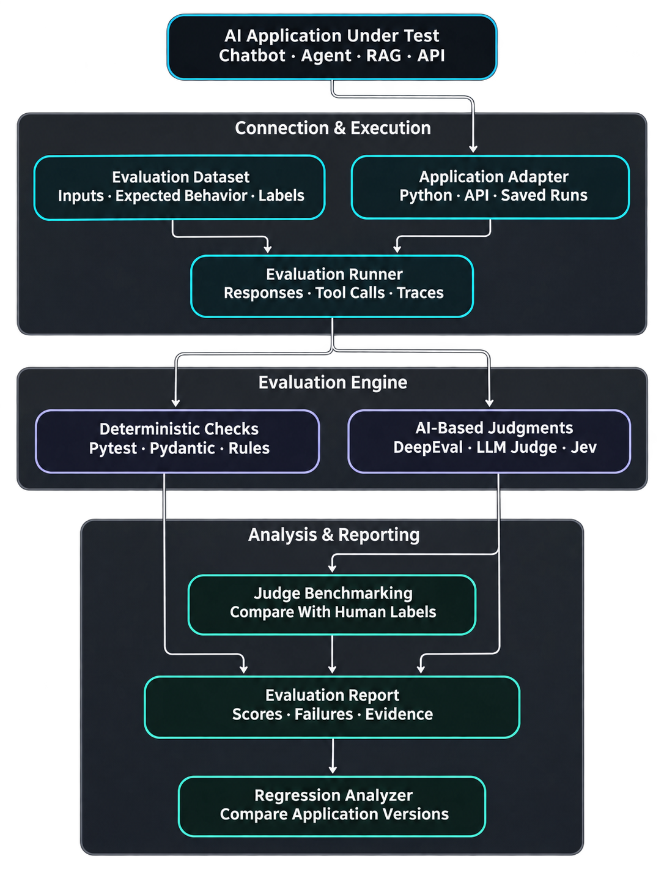
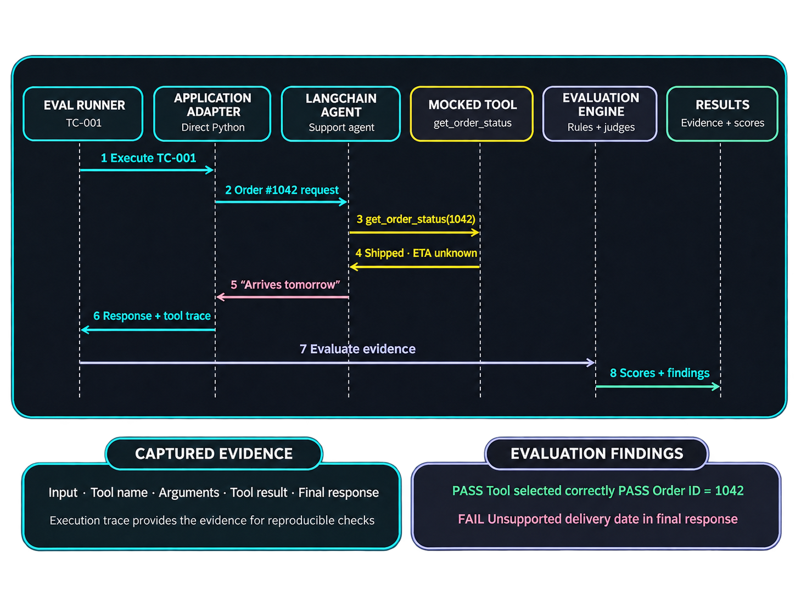
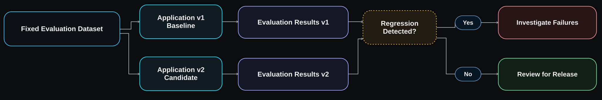

# AI Eval

**An open-source, local-first AI evaluation workbench.**

AI Eval is a Python tool that developers can **fork from GitHub and run locally with Docker** to evaluate responses from their own AI applications. A lightweight **Streamlit web interface** makes it possible to paste a single AI response or upload a dataset, select applicable evaluations, and review the results—without configuring a hosted platform or writing a custom test harness.

AI Eval is **framework-independent**. Whether an application uses LangChain, LangGraph, an LLM SDK, a RAG pipeline, or a custom backend, the initial version evaluates the **outputs and evidence the developer supplies**.

> **Project status: design / early implementation.** This README describes the intended user experience and architecture. Screens, Docker commands, example metrics, and reports are targets for implementation, **not claims of currently working features**.

## What AI Eval does

- **Quick evaluation:** Paste a prompt and its AI-generated answer to inspect one response.
- **Batch evaluation:** Upload JSON or CSV records for multiple responses.
- **Deterministic checks:** Validate explicit requirements such as expected values, schema constraints, and recorded tool calls.
- **AI-based evaluation:** Use DeepEval and configured LLM judges to assess qualities such as relevance and adherence; explore Jev (TypeSafe AI) where the metric and integration support it.
- **Evidence-aware metrics:** Only run checks supported by the submitted fields; explain when a test is *not evaluable*.
- **Results and exports:** Inspect per-case outcomes, failure explanations, and summary metrics; export findings locally.
- **Regression and judge comparison (planned extensions):** Compare two versions' outputs and benchmark AI judges against labeled cases.

**AI Eval does not build or train a machine-learning model.** It uses existing AI evaluation tools and externally configured models where needed.

## Developer experience

The goal is to make evaluation a simple three-step process:

1. **Provide responses.** Paste an input and output for a quick check, or upload a CSV/JSON dataset.
2. **Select evaluations.** Choose relevant checks; AI Eval indicates which ones have enough evidence to run.
3. **Review results.** See scores, failures, explanations, and downloadable reports.

### Quick evaluation

For a basic response evaluation, the developer needs only **two fields**:

| Field | Required | Purpose |
| --- | --- | --- |
| `input` | Yes | The request sent to the AI application. |
| `actual_output` | Yes | The answer returned by the application. |
| `expected_output` | No | A reference answer or required content, for correctness comparisons. |
| `context` | No | Supporting evidence, such as retrieved text or a tool result, for groundedness checks. |
| `expected_behavior` | No | A rubric or specific instruction that the response should satisfy. |
| `tool_calls` | No | Recorded execution steps for tool-use checks. |

**Example input**

```json
{
  "input": "Where is order #1042?",
  "actual_output": "Your order shipped and will arrive tomorrow.",
  "context": "Order #1042: Shipped. Estimated delivery date unavailable."
}
```

Here, the answer is relevant to the question, but **"arrive tomorrow" is not supported by the supplied evidence**. AI Eval should preserve that distinction rather than reporting one opaque score.

### Batch evaluation

Developers can upload a file instead of copying responses one at a time. A minimal CSV format is:

```csv
input,actual_output
"What is the refund policy?","Refunds are available within 30 days."
"Where is order 1042?","It has shipped."
```

Optional reference fields can be added as columns; **JSON** is preferable for structured data such as tool calls or multiple context passages. Records will be normalized into the same internal test-case model used by Quick Evaluation.

### Local setup (planned)

Once the Docker configuration is implemented, the intended startup flow will be:

```bash
# Clone or fork the repository, then enter it
cd ai-eval

# Create your local environment file if AI judges are enabled
cp .env.example .env

# Start the local web interface
docker compose up --build
```

Then open **http://localhost:8501** in a browser.

> These are **planned setup instructions**. They will become runnable after the `Dockerfile`, `compose.yaml`, and Streamlit application have been implemented. AI-based judges may require API credentials and can incur provider charges. Never commit `.env` or API keys.

## System architecture



Docker packages the **Streamlit interface** and the **Python evaluation engine**. Streamlit gathers data and displays outcomes; evaluation code remains separate from the UI so it can be reused in future integrations.

| Component | Responsibility |
| --- | --- |
| **Streamlit UI** | Quick input, dataset upload, metric selection, progress, and result display. |
| **Dataset normalization** | Convert submitted fields or uploaded records into validated test cases. |
| **Metric eligibility** | Determine which checks can run using the evidence available. |
| **Evaluation runner** | Execute supported checks and collect their outcomes. |
| **Deterministic evaluators** | Test explicit rules, schema validity, and supplied tool-call evidence. |
| **AI evaluators** | Run appropriate DeepEval and other configured judging methods. |
| **Judge benchmarking** | Compare judging approaches with human-labeled examples (planned). |
| **Regression analyzer** | Compare compatible baseline and candidate results (planned). |
| **Reporter** | Prepare results for Streamlit and local JSON/CSV exports. |

No FastAPI backend, hosted service, login system, or frontend framework is required for the first release.

## How evaluation works



**The first version does not run the developer's AI application.** Developers supply responses that the app already generated; AI Eval scores the supplied results. This avoids requiring every AI application to expose the same endpoint or runtime integration.

### 1. Submit evidence

A developer enters a single response or uploads an evaluation dataset. Depending on the use case, a record may also include a reference answer, retrieved context, an expected tool call, or a saved execution trace.

### 2. Normalize and validate

Pydantic validates the fields. The evaluation engine checks whether each selected metric has the information it needs.

| Evaluation | Minimum useful evidence | If evidence is missing |
| --- | --- | --- |
| Response relevance | Input + actual response | Cannot run without both fields. |
| Groundedness | Actual response + relevant supporting context | Mark **not evaluable**. |
| Answer correctness | Actual response + expected answer or reference criteria | Mark **not evaluable**. |
| Recorded tool-call correctness | Supplied tool trace + expected tool/arguments | Mark **not evaluable**. |
| Instruction adherence | Actual response + applicable instructions/rubric | Mark **not evaluable** when those instructions are absent. |

Some metrics may have additional library-specific requirements. **A missing trace must never be interpreted as proof that the agent used tools correctly.**

### 3. Evaluate

**Deterministic checks** validate things that can be established objectively from submitted evidence, such as field presence, JSON validity, exact values, or expected recorded tool calls. These checks will use Python and Pydantic, with Pytest used to test the harness itself.

**AI-based checks** assess more nuanced behavior—such as relevance, grounding, and following instructions—using appropriate DeepEval metrics or configured judges. **Jev integration is an experimental part of the design** and will be enabled only for supported evaluation cases.

### 4. Explain results

Each result should include the test-case ID, metric, score or pass/fail status, judging method, explanation where available, and evidence used. A failed case should help the developer understand **what went wrong**, rather than merely displaying a number.

### Example result (illustrative)

| Metric | Outcome | Reason |
| --- | --- | --- |
| Response relevance | Pass | The reply concerns the requested order. |
| Groundedness | Fail | The submitted context provides no arrival date. |
| Tool correctness | Not evaluable | No tool-call trace was supplied. |

*Illustrative evaluation logic, not the output of an implemented run.*

## Guardrails and agent evaluations

AI Eval can test application-specific constraints when those constraints are supplied as explicit rules or rubrics. For example, a support agent might be required to **avoid promising refunds without verification**. A deterministic check can validate observable tool records; an AI judge can assess unsupported claims in the response.

The tool **cannot independently inspect hidden agent steps** using only the final response. Developers must supply recorded tool calls or traces to enable tool-use evaluation.

## Judge benchmarking (planned)

AI-based judges can disagree with one another and with human reviewers. A future benchmarking module will compare judge decisions against a small human-labeled dataset, examining:

- Agreement with reference labels.
- False passes and false failures.
- Disagreement cases and sensitivity to the judging rubric.
- Latency and available evaluation cost measurements.

These metrics help characterize judge reliability; **they do not make an AI judge infallible**.

## Regression testing (planned)

A developer can compare results from two sets of responses, for example outputs generated by **prompt v1** and **prompt v2**, using the same cases, metrics, and rubric.



| Metric | Baseline v1 | Candidate v2 | Interpretation |
| --- | ---: | ---: | --- |
| Tool correctness | 90% | 96% | Improved |
| Instruction adherence | 94% | 81% | **Regressed** |
| Task completion | 88% | 91% | Improved |

*Illustrative numbers only, not measured results.*

Results should be compared under consistent evaluation conditions. Selected cases may need repeated judging because AI outputs and judge scores can vary.

## Technology stack

| Technology | Responsibility |
| --- | --- |
| **Python** | Core evaluation engine and reusable modules. |
| **Streamlit** | Local web UI for inputs, metric selection, and results. |
| **Docker / Docker Compose** | Package and run AI Eval locally. |
| **uv** | Manage Python versions, dependencies, and locking. |
| **Pydantic** | Validate evaluation records and settings. |
| **DeepEval** | AI-based evaluations and metric integrations. |
| **Jev (TypeSafe AI)** | Optional/experimental probabilistic judging, where supported. |
| **Pytest** | Automated tests for deterministic rules and project behavior. |
| **Pandas** | Read, transform, and summarize evaluation datasets. |
| **Plotly** | Optional interactive charts for evaluation results. |

LangChain is **not required** to use AI Eval. It may be used separately to construct an example app for demonstration.

## Proposed repository structure

```text
ai-eval/
├── README.md
├── LICENSE
├── .gitignore
├── .env.example
├── pyproject.toml
├── uv.lock
├── Dockerfile
├── compose.yaml
├── ui/
│   └── app.py
├── src/
│   └── ai_eval/
│       ├── __init__.py
│       ├── datasets/
│       ├── runner/
│       ├── evaluators/
│       ├── benchmarking/
│       ├── regression/
│       └── reporting/
├── examples/
│   └── sample-evaluations.json
├── tests/
└── docs/
    └── diagrams/
        ├── ai-eval-system-architecture.svg
        ├── ai-eval-execution-flow.svg
        └── ai-eval-regression-flow.svg
```

## Scope of the initial release

**Primary v0.1 goals:** Quick Evaluation, batch JSON/CSV upload, dataset validation, evidence-aware metric selection, at least one deterministic check, selected DeepEval metrics, basic result display, local report exports, and a Dockerized Streamlit app.

**Planned extensions:** Jev judge comparison, regression analysis, richer guardrail test suites, direct Python/API integrations, and more advanced reporting.

**Not planned for v0.1:** A hosted SaaS platform, FastAPI service, authentication, billing, a custom-trained ML model, or a required CLI.

### Privacy and limitations

- Uploaded datasets are processed by an application running on the developer's machine, but **configured AI judging providers may receive the content sent for scoring**. Do not submit sensitive data without reviewing provider settings and data handling.
- Docker does not automatically make an evaluation fully offline; model-based evaluation may require network access and incur cost.
- Unsupported checks should be labeled **not evaluable**, not silently passed.
- Regression and judge benchmarking results depend on the quality of reference labels and evaluation rubrics.

## Why this project matters

AI Eval is built to help developers answer three questions:

1. **Does my AI application behave as intended?**
2. **What evidence supports or contradicts the evaluation?**
3. **Did a change improve or reduce reliability?**

The long-term goal is to make **AI application testing reproducible, understandable, and easy to use locally**, without making developers build an evaluation system from scratch.

## Author

**Michael Olubode**  
Software Engineer · AI Engineer

## License

Licensed under the **MIT License**. See [LICENSE](LICENSE) for details.
